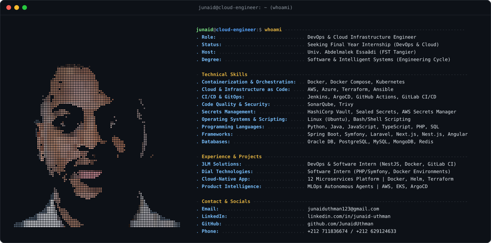

  

  
  &nbsp;
  
  &nbsp;
  

---

### About Me

Hi Everyone! I'm a Final-year software engineering student specializing in DevOps and Cloud Infrastructure. Equipped with a solid foundation in container orchestration, CI/CD automation, declarative GitOps practices and Infrastructure as Code (IaC). Actively seeking a final year internship to drive scalable deployments, with the goal of transitioning into a Junior DevOps Engineer role.

---

## Projects

### [Microservices-Based Real Estate Rental Platform](https://github.com/RealEstate-Rental-JunaidUth-version)

  
  
  
  
  
  

- Containerized 12 microservices with Docker using multi-stage builds and optimized instruction ordering to leverage cache, accelerating build times and ensuring lightweight images.
- Orchestrated microservices across staging and production Kubernetes namespaces using a single parameterized Helm chart, ensuring consistent deployments without duplicating manifests.
- Architected an end-to-end CI/CD pipeline with Jenkins automating tests, SonarQube code analysis, Docker builds, Trivy vulnerability scanning, and Docker Hub publication, followed by GitOps-based continuous delivery via ArgoCD to AWS EKS.

### [Product Intelligence Platform](https://github.com/JunaidUthman/product-intelligence-K8s-Infrastructure)

  
  
  
  
  

- Orchestrated 5 autonomous Python agents via a Kubeflow MLOps pipeline on Kubernetes, automating scraping workflows, data processing, and model training.
- Designed a GitHub Actions CI pipeline automating tests and builds for a data visualization web application, with GitOps-based continuous deployment via ArgoCD to the Kubernetes cluster.
- Deployed the platform on AWS, with the infrastructure fully managed and provisioned via Terraform.

---

## Internships

### 3LM Solutions
*July 2026 – August 2026 &nbsp;|&nbsp; Software &amp; DevOps Engineering Intern*

  
  
  
  
  

- Architected and developed a CRM module with NestJS alongside a React/Next.js frontend for a cloud telephony SaaS platform.
- Containerized the application stack with Docker Compose using multi-stage builds and health checks, ensuring isolated and reproducible environments.
- Built a GitLab CI pipeline automating tests, Docker builds, and Docker Hub releases.

### Dial Technologies
*July 2025 – August 2025 &nbsp;|&nbsp; Software Engineering Intern*

  
  
  
  

- Refactored legacy frontend code and updated corresponding PHP/Symfony backend controllers to modernize the user interface for Autohall’s internal task management platform.
- Streamlined the development workflow by isolating the application stack within a Dockerized local environment to eliminate system dependencies, managing all version control through GitLab.
